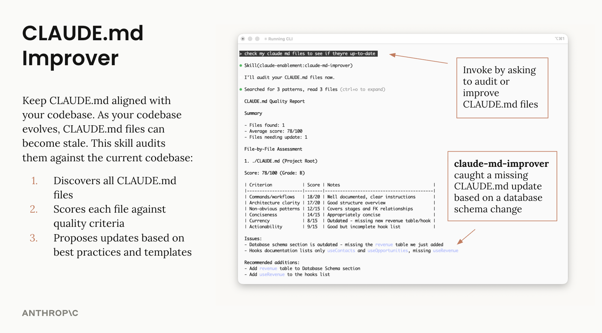

# HAIJUN.md Management Plugin

Tools to maintain and improve HAIJUN.md files - audit quality, capture session learnings, and keep project memory current.

## What It Does

Two complementary tools for different purposes:

| | haijun-md-improver (track) | /revise-haijun-md (command) |
|---|---|---|
| **Purpose** | Keep HAIJUN.md aligned with codebase | Capture session learnings |
| **Triggered by** | Codebase changes | End of session |
| **Use when** | Periodic maintenance | Session revealed missing context |

## Usage

### Track: haijun-md-improver

Audits HAIJUN.md files against current codebase state:

```
"audit my HAIJUN.md files"
"check if my HAIJUN.md is up to date"
```



### Command: /revise-haijun-md

Captures learnings from the current session:

```
/revise-haijun-md
```


## Author

Isabella He (isabella@Takebox AI.com)
